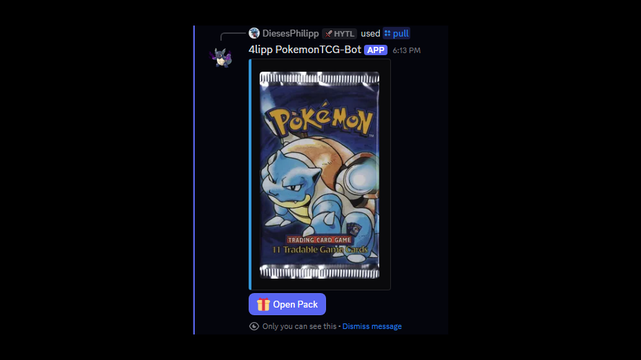
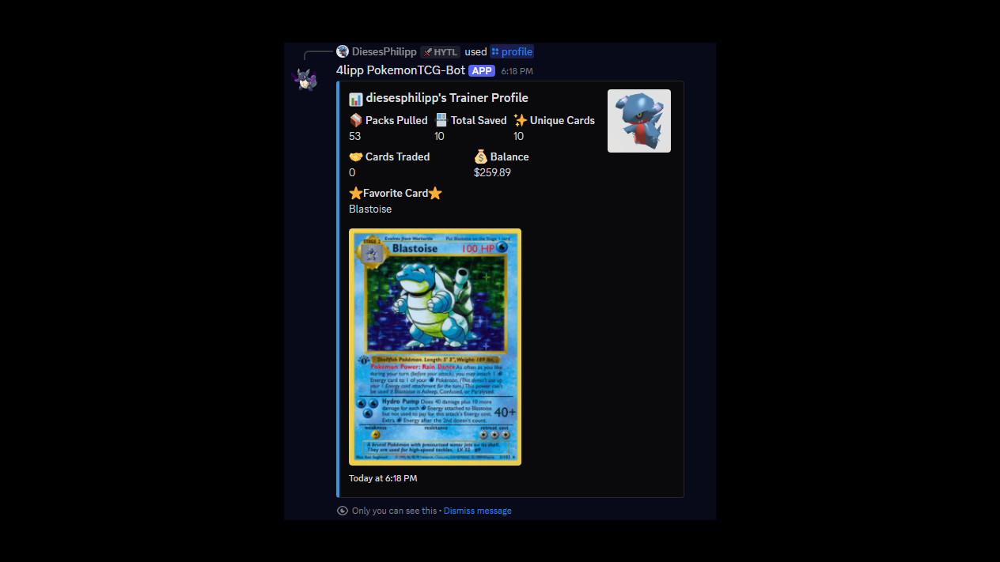
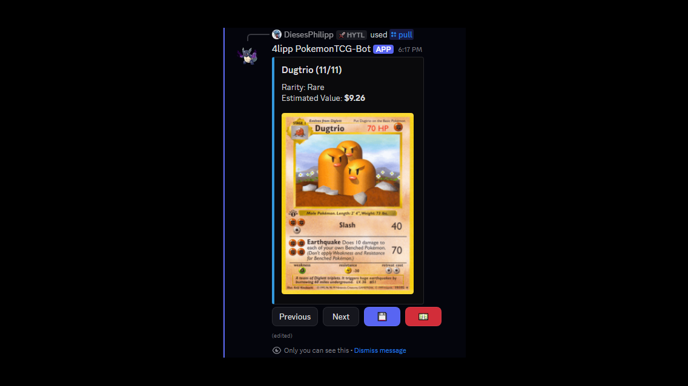

# Pokémon TCG Discord Bot
[](https://www.linkedin.com/in/philipp-spiekermann-a01975352/) [](https://x.com/DiesesPhilipp)

On Discord -> diesesphilipp


A feature-rich Discord bot that brings the Pokémon Trading Card Game experience to your server. Pull packs of random Pokémon cards, manage your personal collection, trade with friends, and more - with card and set data from [TCGdex](https://tcgdex.dev/).

<p align="center">
  
  
  
</p>

## Why

The bot brings pack opening, collecting and trading to a Discord server without any real money involved, using real card data and prices from TCGdex.

**What was hard**

- Discord.Net can stay in `Connecting` forever after a dropped gateway without raising an event. A watchdog polls the connection state and exits after 3 minutes, so Docker restarts a fresh container.
- A trade is confirmed later than it is proposed. On `/confirmtrade` both sides are checked again (cards still owned, not locked, enough coins) and nothing changes if any check fails.
- Moving existing users from JSON files to a database without losing collections: a one-time importer reads the old files and leaves them untouched as a backup.

**Trade-offs**

- The card list of a set is cached in memory for 12 hours. One API call per set instead of one per card on every pull, at the cost of card prices being up to 12 hours old.
- Card detail requests to TCGdex run in parallel but throttled, so a large pull stays fast without flooding the API.

---

## Table of Contents

- [Features](#features)
- [Installation](#installation)
- [Configuration](#configuration)
- [Usage](#usage)
- [Commands](#commands)
- [Bot Architecture](#bot-architecture)
- [Contributing](#contributing)
- [License](#license)
- [Acknowledgements](#acknowledgements)

---

## Features

- **Pack Pulling:**  
  Pull a booster pack using `/pull [set-id]`. Pack size, rarity odds per slot, price and cover images are configured per set in `Data/packSettings.json` (e.g. 11 cards for Base Set, 10 for Scarlet & Violet, 5 for TCG Pocket).
  
- **Collection Management:**  
  View your saved cards with `/inventory` and manage your collection directly in Discord.

- **Set Browsing:**  
  Use `/sets` to see a list of Pokémon card sets.

- **Trading System:**  
  Initiate trades with other users using `/trade [user] [give-card] [receive-card] [receive-money]` along with commands to confirm (`/confirmtrade`) or cancel (`/canceltrade`) a trade.

- **Expeditions:**  
  Send cards off to a location with `/expedition start [location] [cards]`, check progress with `/expedition status`, and collect coin and card rewards with `/expedition claim` once the timer finishes. Cards on an expedition are locked and can't be sold or traded until claimed.

- **User Profiles:**  
  Display user profiles with `/profile [user]` to see their stats: packs pulled, cards saved, unique cards, cards traded, balance and favorite card.

- **Administrative Commands:**  
  Admins can lock or unlock specific card sets (`/lockset [set-id]` and `/unlockset [set-id]`), restart the bot (`/restart`), or control its active status using `/turnon`/`/turnoff`. Any user can view bot statistics with `/stats`.

- **Robust Command Handling:**  
  Commands are processed using a dedicated command handler with logging and detailed error reporting.

---

## Installation

### Prerequisites

- [.NET 8.0 SDK](https://dotnet.microsoft.com/download)
- A Discord account and a bot token (obtain one via the [Discord Developer Portal](https://discord.com/developers/applications))

### Setup Steps

1. **Clone the Repository:**

   ```bash
   git clone https://github.com/Dieses4lipp/Pokemon-TCG-Discord-Bot
   cd Pokemon-TCG-Discord-Bot
   ```

2. **Configure Environment Variables:**

   Create a `.env` file or set environment variables in your preferred way. **Important:** Store your bot token only in this file and never share it publicly. For example, your `.env` file should look like:

   ```env
   TOKEN=your_new_discord_bot_token_here
   # Optional: Discord user ID allowed to run the admin commands (/lockset, /addbalance, /restart, ...).
   # Defaults to the owner of the Discord application.
   OWNER_ID=your_discord_user_id
   # Optional: where the SQLite database lives. Defaults to data/bot.db next to the binary
   # (/app/data/bot.db in the container).
   DATABASE_PATH=data/bot.db
   # Optional: sqlite (default) or postgres. Postgres needs DB_CONNECTION and keeps its tables
   # in the schema "pokebot".
   # DB_PROVIDER=postgres
   # DB_CONNECTION=Host=db.lan;Port=5432;Database=apps;Username=pokebot;Password=...
   ```

   `.env.example` lists every setting.

3. **Restore Dependencies and Build:**

   ```bash
   dotnet restore
   dotnet build
   ```

4. **Run the Bot:**

   ```bash
   dotnet run
   ```

---

## Configuration

- **Command Architecture:**  
  The bot listens strictly to Discord Application (Slash) Commands executing directly through integrations instead of the old-school text message prefix parsing mechanism.

- **API Endpoints:**  
  The bot fetches card and set data from the TCGdex API (`https://api.tcgdex.net/v2/`). Update the URLs in the `CardApiClient` class if necessary.

- **Storage:**  
  Collections, balances, expeditions, locked sets, the on/off switch and open trades and packs live in one database, through EF Core: an SQLite file (`DATABASE_PATH`, default `data/bot.db`) or, with `DB_PROVIDER=postgres`, the Postgres database in `DB_CONNECTION` (tables in the schema `pokebot`, migration history included, so the database can be shared). An unknown `DB_PROVIDER`, or a `DB_CONNECTION` that is missing for Postgres or set without `DB_PROVIDER=postgres`, stops the bot at startup. The schema is created and upgraded on startup by the EF migrations in `Migrations/Sqlite` and `Migrations/Postgres`; an SQLite file from before EF Core is taken over as is (it already has the initial migration's schema). Every card copy has its own ID, balances are stored in cents, and a trade writes both collections in one transaction.  
  New migrations are added per provider: `dotnet ef migrations add <Name> --context SqliteBotDbContext --output-dir Migrations/Sqlite`, and the same with `PostgresBotDbContext` and `Migrations/Postgres`.  
  On the first start the bot imports the JSON files older versions kept in `UserCards/` (`*.json`, `Left/*.json`, `State/botState.json`). The files are only read, never changed; pending trades are not imported and have to be proposed again. The import runs once and skips users the database already has.

- **Moving to Postgres:**  
  Stop the bot, then run it once with `--migrate-sqlite-to-postgres <path to bot.db>` and `DB_PROVIDER=postgres` plus `DB_CONNECTION` set (in the container: `docker compose run --rm -e DB_PROVIDER=postgres -e DB_CONNECTION=... bot --migrate-sqlite-to-postgres /app/data/bot.db`). It creates the schema, copies every row with its ID in one transaction and refuses a database that already holds bot data. Then set `DB_PROVIDER` and `DB_CONNECTION` for the bot and start it. The SQLite file is kept as it was, apart from EF Core's history table if it predates EF Core.

- **Backups:**  
  With SQLite, once a day the bot writes a consistent copy of the database to `backups/` next to it (`/app/data/backups` in the container) and keeps the newest 7. `ops/pokebot-backup.sh` with its systemd timer copies the newest one to the NAS share; it needs `smbclient` and a credentials file on the host (see the script). To restore, stop the bot and replace `bot.db` with a copy (delete `bot.db-wal` and `bot.db-shm` too). With Postgres the bot writes no backups; back up the database on the server.

- **Logging:**  
  Logging goes through `Microsoft.Extensions.Logging` to the console (one line per entry, with timestamp), including full exceptions with stack traces.

- **Pack settings:**  
  Profiles (cards per pack, slots, rarity odds, price) are edited by hand in `Data/packSettings.json`. The `sets` section is generated from the folders in `Assets/sets_covers`: after adding a cover folder, run `python tools/gen_pack_settings.py`. To check the rarity names in the profiles against TCGdex, run `python tools/check_pack_rarities.py`; it lists every rarity a set has that no slot can roll.

- **Tests:**  
  `dotnet test` runs the tests in `tests/DiscordBot.Tests` (pack building, pack settings validation and a check that the shipped `Data/packSettings.json` is valid, trades and expeditions, the repositories, the schema takeover of old `bot.db` files and the JSON import). The Postgres tests use the server in `POKEBOT_TEST_POSTGRES` (a connection string) or start one with Testcontainers; without either they are skipped, except in CI. CI runs them before building the image.

- **Security Note:**  
  **Never share your bot token publicly!** Always store it securely in your environment variables or configuration files (e.g., the `.env` file). If your token is ever exposed, reset it immediately through the [Discord Developer Portal](https://discord.com/developers/applications).

---

## Usage

Once the bot is running and added to your Discord server, interact with it using the commands listed below. It automatically logs in, connects, registers its slash commands in every server it is in (per server, not globally), and starts listening for command interactions properly matching typical slash integration logic.

---

## Commands

### General Commands

- **`/pull [set-id] [language? (default: english)]`**  
  Pulls a booster pack from the given set. The pack follows the set's profile in `Data/packSettings.json`: number of cards, rarity chances per slot (e.g. common, uncommon, reverse holo, rare slot) and pack price.

- **`/inventory`**  
  Displays your saved Pokémon cards.

- **`/sets`**  
  Shows up to 24 Pokémon card sets from TCGdex, sorted by name.

- **`/profile [user]`**  
  Displays the stats of the specified user: packs pulled, cards saved, unique cards, cards traded, balance and favorite card.

- **`/help`**  
  Lists all available commands.

- **`/stats`**  
  Displays various statistics about the bot’s usage and performance.

### Trading Commands

- **`/trade [user] [give-card] [receive-card] [receive-money]`**  
  Proposes a trade: you give one card and receive a card, coins, or both. `receive-card` and `receive-money` are optional.

- **`/confirmtrade`**  
  Confirms an ongoing trade.

- **`/canceltrade`**  
  Cancels an active trade session (End the trade session).

### Expedition Commands

- **`/expedition start [location] [cards]`**  
  Sends a comma-separated list of owned, unlocked cards off on an expedition to the given location. Locks the cards until claimed. Fails if you already have an expedition in progress.

- **`/expedition status`**  
  Shows the location, sent cards, and remaining time (or claim readiness) of your active expedition.

- **`/expedition claim`**  
  Once the expedition timer is up, claims the coin reward (and a chance at bonus cards), unlocks the sent cards, and clears the expedition so a new one can be started.

### Administrative Commands

- **`/unlockset [set-id]`**  
  Unlocks a specific Pokémon card set to allow pulls again. *(Admin only)*

- **`/lockset [set-id]`**  
  Locks a specific set to prevent cards from being pulled. *(Admin only)*

- **`/restart`**  
  Restarts the bot. *(Admin only)*

- **`/turnon` / `/turnoff`**  
  Turns the bot on or off, enabling or disabling command processing. *(Admin only)*

- **`/addbalance [user] [amount]` / `/setbalance [user] [amount]`**  
  Adds to (negative amounts remove from) or sets a user's balance. The balance can't go below 0. *(Admin only)*

- **`/givecard [user] [card-id]`**  
  Adds a card to a user's collection by its TCGdex card ID, e.g. `swsh1-25`. *(Admin only)*

- **`/removecard [user] [card-name]`**  
  Removes one copy of a card from a user's collection. Cards on an expedition can't be removed. *(Admin only)*

- **`/userinfo [user]`**  
  Shows a user's balance, collection size, stats, favorite card and running expedition. *(Admin only)*

- **`/expedition-admin list` / `edit [location] ...` / `reload`**  
  Lists the expedition locations, changes one (only the options you pass: name, duration, reward range, card reward chance, count and set, `random` for a random set) or resets all of them to `Data/expeditionSettings.json`. Locations live in the database: the file only fills it on the first start and is what `reload` resets to, so edits survive restarts and deploys. *(Admin only)*

- **`/expedition-admin inspect [user]` / `finish [user]`**  
  Shows a user's running expedition, or ends it now so the user can claim it right away. *(Admin only)*

For a full list of commands, type `/help` in Discord.

### Help Command

The `HelpModule` sends a rich embed listing all available commands and their usage. This module is automatically registered along with other commands during the bot`s startup.

---

## Bot Architecture

### Bot Initialization

The bot is initialized in the `Bot` class, which sets up logging, connects to Discord, and listens for slash commands (`/`). Commands are executed using the Discord.NET interaction command framework.

### Command Handling

Commands are processed via slash command interaction routing, which ensures:
- Input parameters and user permissions are automatically validated before execution.
- Interactions are handled by their assigned module handlers.
- Errors are logged and reported back securely and ephemerally in the Discord channel.


---

## Contributing

Contributions are welcome! If you have ideas or improvements:

1. Fork the repository.
2. Create a feature branch: `git checkout -b feature/my-new-feature`
3. Commit your changes: `git commit -am 'Add new feature'`
4. Push your branch: `git push origin feature/my-new-feature`
5. Submit a pull request.

---

## License

This project is licensed under the MIT License. See the [LICENSE](LICENSE) file for details.

---

## Acknowledgements

- [TCGdex](https://tcgdex.dev/) for providing the card data.
- [Discord.NET](https://github.com/discord-net/Discord.Net) for the Discord API library.
- The open-source community for support and contributions.

---

Happy collecting!
